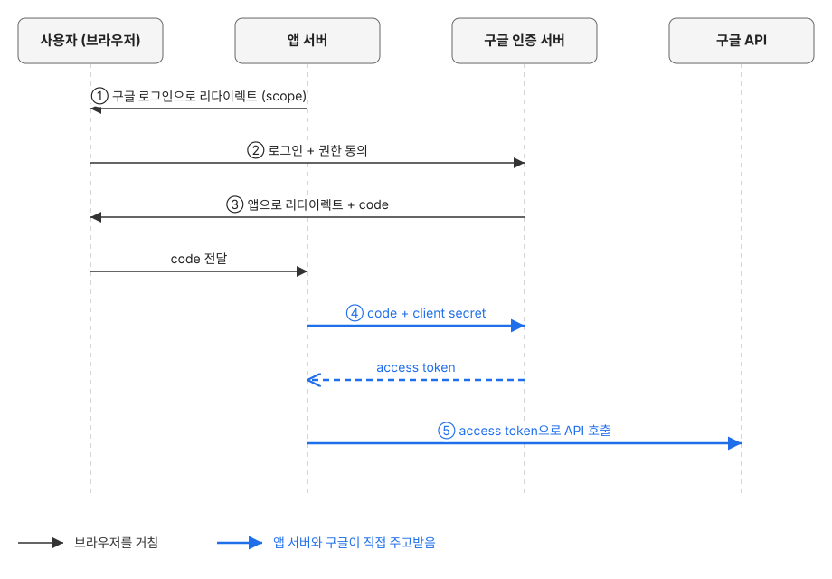
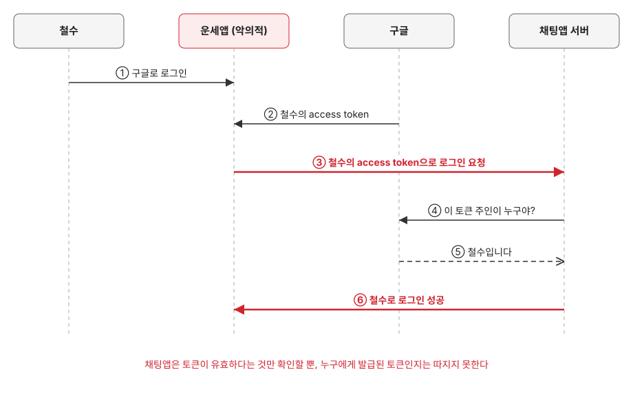
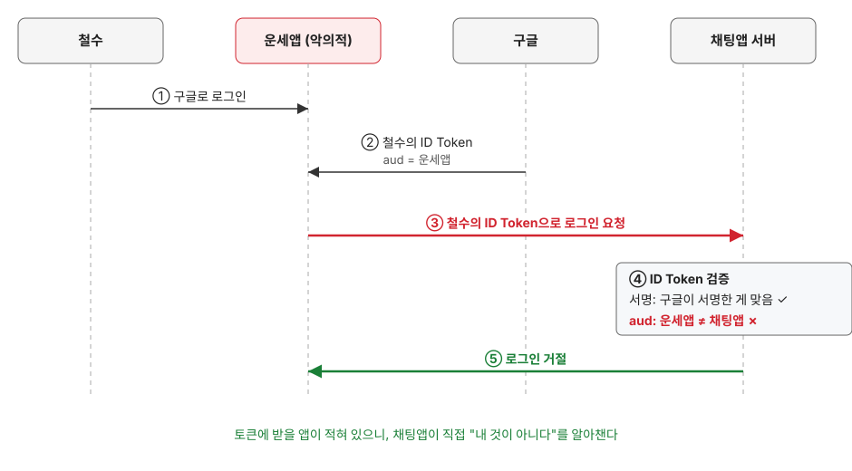

최근 인증과 인가와 관련된 내용이 많이 나와서 이참에 어떤 건지 파헤쳐 보기로 했다

먼저, 기본적으로 인증과 인가는 예전에 정보처리기사에도 나왔듯 자주 나오는 개념이기도 하고 헷갈리는 개념이기도 하다 (둘 다 a로 시작한다)

인증 -> 인가 순으로 진행되며,

|                        | 인증 (authentication)                        | 인가 (authorization)                                       |
| ---------------------- | -------------------------------------------- | ---------------------------------------------------------- |
| 묻는 것                | 누구인지 체크                                | 무엇을 할 수 있는지 체크                                   |
| 대표적인 확인 방법     | 비밀번호, OTP, 생체 인식, 소셜 로그인        | 역할(관리자/일반 사용자), 리소스별 권한 목록, 토큰의 scope |
| 실패 시 HTTP 상태 코드 | 401 Unauthorized (이름과 달리 "누군지 모름") | 403 Forbidden (누군지는 알지만 권한 없음)                  |

대략적으로 위와 같이 정리할 수 있다.

그리고 여기서 이번에 글의 주제가 되는 oauth2, oidc가 나오게 된다.

먼저 oauth2부터 알아보려고 한다.

최근에는 소셜 로그인이 정말 많다. 구글, 카카오, 네이버 로그인은 웬만한 사이트라면 다 지원하고 있다.

그리고 여기서 쓰이는 것이 oauth2인데, 이름에 2가 붙은 걸 보면 알 수 있듯 그 전에 1.0이 있었다.

### oauth 1.0의 시작

다음의 상황을 가정해보도록 하겠습니다.

개발자 A가 새로운 채팅앱을 만들었는데, 유저의 친구 중에 이미 가입된 유저들이 있는지 찾는 기능을 개발하려고 합니다.

당연히 개발자가 만든 앱에서는 유저의 친구 정보들을 모르니 유저의 지메일 정보를 가져오고 자체 db의 이메일을 이용해서 조회하면 어찌저찌 될 것 같습니다.

oauth가 나오기 전에는 다른 서비스의 데이터를 쓰고 싶은 앱이 사용자의 **비밀번호를 직접** 받아 갔다. 예를 들어 어떤 앱이 내 Gmail 주소록을 가져오려면 내 구글 아이디와 비밀번호를 그 앱에 입력해야 했다.

이 방식은 문제가 많았다.

- 앱이 비밀번호를 저장하니 앱이 털리면 구글 계정까지 털린다
- 앱이 비밀번호로 로그인하면 구글은 그게 나인지 앱인지 구별하지 못한다. 그래서 주소록만 필요한 앱도 메일 읽기, 삭제는 물론 비밀번호 변경까지 나와 똑같이 할 수 있다
- 앱이 비밀번호를 저장해 두고 계속 쓰기 때문에, 특정 앱만 끊으려 해도 비밀번호를 바꾸는 수밖에 없다. 그러면 비밀번호를 줬던 다른 앱들까지 전부 끊긴다

이걸 해결하려고 2007년 트위터 개발자들을 중심으로 표준 작업이 시작됐고, 2010년 RFC 5849로 oauth 1.0이 정리됐다. 핵심 아이디어는 비밀번호 대신 **토큰**을 주자는 것이다. 사용자는 구글 화면에서 직접 로그인하고 "이 앱에 주소록 읽기를 허락할까요?"에 동의만 한다. 앱은 비밀번호를 끝까지 모른 채, 허락받은 범위만 쓸 수 있는 토큰을 받는다.

다만 1.0은 요청마다 토큰과 비밀키로 서명을 만들어 붙여야 해서 구현이 까다로웠다. 그래서 2012년 RFC 6749로 나온 oauth 2.0은 서명을 빼고 보안을 HTTPS에 맡겨 훨씬 단순해졌고, 웹뿐 아니라 모바일 앱 등을 위한 흐름도 여러 개 정의했다. 이름은 이어지지만 1.0과 호환되지 않는 사실상 새 규격이다.

### oauth가 뭔지

정리하면 oauth는 **내 비밀번호를 넘기지 않고, 내 데이터에 대한 접근 권한 일부를 다른 앱에 빌려주는 방법**이다. 앞의 표로 보면 인증이 아니라 **인가**에 해당한다.

등장인물은 넷이다.

| 역할                 | 설명                                   | 예시               |
| -------------------- | -------------------------------------- | ------------------ |
| Resource Owner       | 데이터의 주인                          | 나                 |
| Client               | 데이터를 쓰고 싶은 앱                  | 주소록 가져오기 앱 |
| Authorization Server | 사용자를 확인하고 토큰을 발급하는 서버 | 구글 로그인 서버   |
| Resource Server      | 실제 데이터를 가진 API 서버            | 구글 주소록 API    |

가장 많이 쓰이는 Authorization Code 흐름은 대략 이렇다.

1. 앱이 사용자를 구글 로그인 화면으로 보낸다. 어떤 권한이 필요한지는 `scope`에 담는다
2. 사용자가 구글에서 로그인하고 권한 요청에 동의한다
3. 구글이 사용자를 앱으로 돌려보내면서 일회용 **authorization code**를 붙여준다
4. 앱의 서버가 이 code와 자기 client secret을 구글에 보내 **access token**으로 바꾼다
5. 앱은 access token을 들고 구글 API를 호출한다



code를 한 번 거쳐서 토큰으로 바꾸는 이유는 3번이 브라우저 주소창을 지나가기 때문이다. 노출되기 쉬운 곳에는 그 자체로는 쓸모없는 code만 싣고, 실제 토큰은 4번에서 앱 서버와 구글이 직접 주고받는다.

여기서 걸리는 점이 하나 있다. access token은 "이 토큰을 가진 쪽은 주소록을 읽을 수 있다"는 뜻일 뿐, **지금 로그인한 사람이 누구인지는 알려주지 않는다.** 그런데 소셜 로그인에 필요한 건 바로 그 "누구인지", 즉 인증이다. 이 빈칸을 채우려고 나온 것이 oidc다.

### oidc가 뭔지

oidc는 OpenID Connect의 줄임말로, 2014년 OpenID Foundation이 만든 표준이다. oauth 2.0을 갈아엎은 새 규격이 아니라, **oauth 2.0 흐름은 그대로 두고 "누가 로그인했는가"를 알려주는 부분만 얹은 것**이다.

그래서 앞의 흐름에서 달라지는 건 두 군데뿐이다.

- 1번에서 `scope`에 `openid`를 넣는다. 권한만 빌려 달라는 게 아니라 로그인한 사람이 누구인지도 알려 달라는 신호다
- 4번에서 구글이 access token과 함께 **ID Token**을 돌려준다

### ID Token

ID Token은 JWT 형식의 토큰이고, 구글이 서명해서 준다. 안을 열어 보면 대략 이렇게 생겼다.

```json
{
  "iss": "https://accounts.google.com",
  "sub": "110169484474386276334",
  "aud": "<우리 앱의 client_id>",
  "iat": 1793176800,
  "exp": 1793180400,
  "email": "user@gmail.com",
  "name": "홍길동"
}
```

| 항목                                     | 뜻                                             |
| ---------------------------------------- | ---------------------------------------------- |
| `iss` (issuer)                           | 누가 발급했나                                  |
| `sub` (subject)                          | 이 사용자의 고유 ID. 구글 안에서 바뀌지 않는다 |
| `aud` (audience)                         | 이 토큰을 받을 앱                              |
| `iat` (issued at), `exp` (expiration time) | 발급 시각, 만료 시각                           |
| `email`, `name` 등                       | `scope`에 따라 들어가는 사용자 정보            |

앱은 서명이 구글 것이 맞는지, `iss`가 구글인지, `aud`가 우리 앱인지, `exp`가 지나지 않았는지 확인한 뒤 `sub`로 사용자를 찾는다. 앞의 채팅앱이라면 `sub`로 회원을 조회해서 있으면 로그인시키고, 처음 보는 `sub`면 가입시키면 된다. 이메일은 사용자가 바꿀 수 있으니 회원을 식별하는 키로는 `sub`를 쓴다.

### access token으로 로그인하면 안 되나

oidc 없이도 access token으로 구글 API를 불러 사용자 정보를 가져오면 로그인처럼 쓸 수는 있다. 실제로 oidc가 나오기 전에는 이렇게 많이 했다. 문제는 access token이 **API 서버를 위한 토큰**이라는 점이다.

access token은 "이 토큰을 가진 쪽은 주소록을 읽을 수 있다"는 것만 말해줄 뿐, **어느 앱에게 발급된 토큰인지는 담고 있지 않다.** 구글이 따로 조회 API를 열어 두기도 하지만 oauth 표준에 정해진 방법은 없다.

이게 왜 문제인지 앞의 채팅앱에 상황을 하나 더해 보자. 채팅앱과는 아무 상관 없는 운세앱이 있고, 이 앱도 구글 로그인을 쓴다. 그런데 운세앱 운영자가 나쁜 마음을 먹었다. 그리고 채팅앱 서버는 "구글 access token을 보내 주면 그걸로 누군지 확인해서 로그인시켜 준다"는 식으로 만들어져 있다.



1. 철수가 운세앱에 구글로 로그인한다
2. 운세앱은 정상적으로 철수의 access token을 받는다. 여기까지는 아무 문제가 없다
3. 운세앱 운영자가 이 토큰을 채팅앱 로그인 API에 그대로 보낸다. 채팅앱 모바일 앱이 보내는 요청을 흉내 내기만 하면 된다
4. 채팅앱은 구글에 "이 토큰 주인이 누구야?"라고 묻는다
5. 토큰은 진짜이니 구글은 정직하게 "철수"라고 답한다
6. 채팅앱은 철수로 로그인시킨다

운세앱 운영자는 철수의 비밀번호를 모르는데도 채팅앱에 철수로 들어갔다. 철수의 대화를 읽고, 철수인 척 친구들에게 메시지를 보낼 수도 있다. 철수는 운세앱에 로그인 한 번 했을 뿐인데 채팅앱 계정까지 넘어간 것이다.

토큰도 진짜고 구글도 거짓말을 하지 않았다. 문제는 채팅앱이 "이 토큰이 **나한테** 오려고 발급된 건가?"를 따질 수 없었다는 데 있다. 운세앱 입장권을 들고 왔는데, 구글 도장이 찍혀 있다는 이유로 채팅앱 입구를 통과시킨 셈이다.

ID Token은 바로 이 입장권에 "채팅앱 전용"이라고 적어 둔다. 같은 상황을 oidc로 바꾸면 이렇게 된다.



운세앱이 받은 철수의 ID Token에는 `aud`에 운세앱의 client_id가 적혀 있다. 운세앱이 이걸 채팅앱에 들고 와도, 채팅앱은 `aud`가 자기 client_id가 아닌 걸 보고 바로 거절한다. `aud`를 운세앱이 몰래 바꿀 수도 없다. 구글이 서명한 토큰이라 한 글자만 바뀌어도 서명 검증에서 걸린다.

구글에 물어볼 필요도 없다는 점도 다르다. ID Token은 그 자체로 "구글이 **채팅앱에게**, 이 사람이 **방금 로그인했다**고 보증한다"는 내용을 담고 있어서, 채팅앱이 직접 서명과 `aud`를 확인하면 끝이다.

다만 이 확인을 하는 건 채팅앱의 몫이다. 구글은 `aud`를 적고 서명해 줄 뿐이고, 채팅앱이 `aud` 검사를 빼먹으면 ID Token을 써도 위의 공격은 그대로 통한다. 그래서 ID Token을 받으면 서명, `iss`, `aud`, `exp`를 꼭 검증해야 한다.

채팅앱 서버의 로그인 API로 두 방식을 비교하면 이렇다. 먼저 access token으로 로그인시키는 방식이다.

```ts
// 위험: access token으로 로그인
POST /auth/google { accessToken }

  // 구글은 토큰이 유효하면 주인을 알려줄 뿐, 누구에게 발급된 토큰인지는 따지지 않는다
  userInfo = 구글_사용자정보_API(accessToken)

  user = DB에서_찾기(iss: "https://accounts.google.com", sub: userInfo.sub)
  if (!user) user = 회원가입(userInfo)

  return 채팅앱_세션_발급(user)
```

운세앱이 받아 둔 철수의 access token을 보내도, 구글은 "철수"라고 답하니 그대로 로그인된다. 다음은 ID Token을 검증하는 방식이다.

```ts
// 안전: ID Token 검증 후 로그인
POST /auth/google { idToken }

  // 구글에 묻지 않는다. 미리 받아 둔 구글 공개키로 서명을 직접 확인한다
  if (!서명_검증(idToken, 구글_공개키)) return 401

  claims = idToken의_내용

  if (claims.iss != "https://accounts.google.com") return 401
  // 운세앱에 발급된 토큰은 여기서 걸린다
  if (claims.aud != 채팅앱_CLIENT_ID) return 401
  if (claims.exp < 지금) return 401

  user = DB에서_찾기(iss: claims.iss, sub: claims.sub)
  if (!user) user = 회원가입(claims)

  // 구글 토큰을 세션으로 계속 쓰지 않고, 확인이 끝나면 우리 세션을 새로 발급한다
  return 채팅앱_세션_발급(user)
```

운세앱 공격을 막는 건 결국 `aud` 검사 한 줄이다. 이 한 줄이 "구글이 확인한 사람"과 "구글이 **채팅앱에게** 확인해 준 사람"을 가른다. 실제로는 구글 공식 라이브러리 같은 검증 라이브러리가 위의 검사를 한 번에 해 주고, 채팅앱은 자기 client_id만 넘기면 된다.

위 코드는 모바일 앱이 ID Token을 들고 서버로 오는 경우다. 서버가 code를 받아 구글 토큰 엔드포인트에서 직접 ID Token을 받아 오는 경우라면 사정이 조금 다르다. 가운데에 끼어들 자리가 없어서 서명 검증을 생략할 수 있고, show-gi도 그렇게 했다. 이건 [ID Token 검증 편](/blog/id-token-validation/)에서 따로 다룬다.

그 밖에 oidc는 사용자 정보를 더 가져오는 UserInfo 엔드포인트, 발급자의 설정을 `/.well-known/openid-configuration`에서 자동으로 알아내는 Discovery 같은 것도 표준으로 정해 두었다. 덕분에 구글이든 카카오든 oidc를 지원하는 곳이면 같은 방식으로 로그인을 붙일 수 있다.

### 정리

|                | oauth 2.0                       | oidc                            |
| -------------- | ------------------------------- | ------------------------------- |
| 답하는 질문    | 이 앱이 무엇을 할 수 있는가     | 지금 로그인한 사람이 누구인가   |
| 인증·인가      | 인가                            | 인증                            |
| 핵심 토큰      | access token                    | ID Token                        |
| 토큰을 읽는 쪽 | API 서버                        | 앱                              |

oidc 흐름에서는 두 토큰을 같이 받지만 쓰임새가 다르다. ID Token은 앱이 로그인 처리에 쓰고, API를 호출할 때는 여전히 access token을 쓴다. 소셜 로그인 버튼 하나 뒤에서 인증과 인가가 이렇게 나뉘어 돌아가고 있었다.

이 글은 show-gi에 구글 로그인을 붙이며 정리한 연작의 첫 편이다. 다음 편 [state와 PKCE는 각각 무엇을 막나](/blog/state-vs-pkce/)에서는 Authorization Code 흐름에서 code를 노리는 공격 두 가지를 다룬다.
