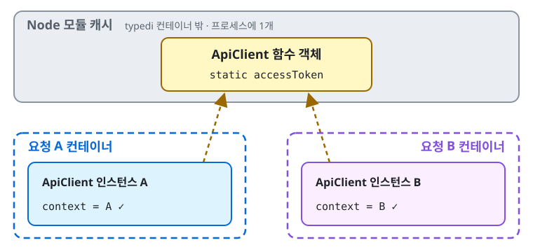
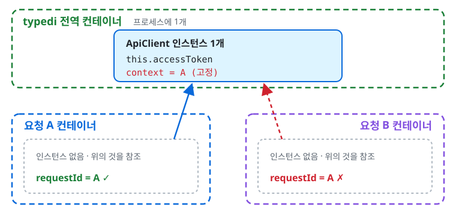
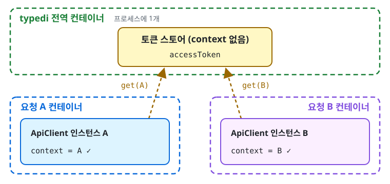

외부 API를 부르는 `ApiClient`가 있었다. 이 클래스는 외부 API의 액세스 토큰을 인스턴스 필드에 들고 있었는데, 로그를 보니 요청이 들어올 때마다 토큰을 새로 발급받고 있었다. typedi가 요청마다 새 컨테이너를 만들고, 그 안에서 `ApiClient`도 새로 `new` 하기 때문이다. 인스턴스가 매번 새로 생기니 인스턴스 필드에 둔 토큰도 매번 비어 있었다.

그래서 토큰을 `static` 필드로 옮겼다.

```ts
@Service()
class ApiClient {
  private static accessToken?: string;

  constructor(@Inject("context") private readonly context: RequestContext) {}
}
```

리뷰에서 질문이 하나 달렸다. "typedi에 `Container.set({ ..., global: true })`도 있는데, static이랑 뭐가 다른가요?" 둘 다 "한 번 만들어서 같이 쓴다"는 점에서는 비슷해 보인다. 그런데 공유되는 범위가 다르다.

### static 필드는 클래스라는 함수 객체에 붙는다

JS의 클래스는 함수 객체다. 함수도 객체라서 프로퍼티를 붙일 수 있다.

```ts
function hello() {}
hello.count = 3; // 된다
```

static 필드는 이 함수 객체에 붙는 프로퍼티다. `ApiClient.accessToken = "..."`과 같다. 반면 인스턴스 필드는 `new` 할 때마다 새로 생기는 객체에 붙는다. 참고로 TS의 `private`은 컴파일 타임 검사일 뿐이라 런타임에는 평범한 프로퍼티다. 테스트에서 `Reflect.set`으로 값을 비울 수 있는 것도 그래서다.

그럼 이 함수 객체는 몇 개일까. Node는 파일을 처음 import할 때 한 번 실행하고 그 결과(exports)를 캐시한다. 이후 import는 캐시에 있는 같은 객체를 돌려준다. 그래서 `ApiClient` 함수 객체는 프로세스에 하나뿐이고, 거기 붙은 static 값도 하나다. 프로세스가 여러 개면 각자 따로 가지고, 재시작하면 사라진다.



중요한 건 이 값이 **typedi 컨테이너 밖**에 있다는 점이다. 인스턴스는 여전히 요청마다 새로 만들어지고, 각자 자기 요청의 `context`를 주입받는다. 토큰만 클래스 쪽에 하나 있을 뿐이다.

### global: true는 인스턴스를 통째로 공유한다

typedi에는 처음부터 전역 컨테이너가 하나 있고, `@Service()`로 등록한 정보는 전부 여기에 들어 있다. 요청마다 만드는 컨테이너는 서비스를 `get()` 할 때 이 등록 정보를 복제하는데, 값(인스턴스)은 비운 채로 복제해서 자기 안에서 새로 `new` 한다.

`global: true`로 등록한 서비스는 이 복제를 건너뛴다. 요청 컨테이너가 전역 컨테이너의 인스턴스를 그대로 돌려준다. 복사본이 아니라 같은 참조다.



`ApiClient`를 이렇게 등록하면 토큰은 공유되지만, 인스턴스가 통째로 하나이니 생성자에서 주입받은 `context`까지 공유된다. 인스턴스가 처음 만들어질 때의 요청, 즉 요청 A의 `context`가 그대로 박힌다. 요청 B가 외부 API를 불러도 `requestId` 헤더에는 A가 찍힌다. 로그로 요청을 추적할 때 엉뚱한 요청으로 이어지는 셈이다. 토큰 발급 요청에도 `requestId`를 싣고 있었다면 함정이 하나 더 생긴다.

### 공유할 것만 따로 떼면 된다

global을 쓰고 싶다면, 토큰만 맡는 클래스를 따로 두고 그것만 `global: true`로 등록하면 된다. 이 클래스는 요청 스코프의 값을 주입받지 않는다. `requestId`가 필요하면 주입이 아니라 인자로 받는다.

```ts
@Service({ global: true })
class TokenStore {
  private accessToken?: string;

  async get({ requestId }: { requestId: string }) {
    if (!this.accessToken) this.accessToken = await issueToken({ requestId });
    return this.accessToken;
  }
}
```



이 구조는 static으로 둔 첫 번째 그림과 동작이 같다. 토큰은 프로세스에 하나, `context`는 요청마다 하나다.

### 정리

static이냐 global이냐는 수단의 차이일 뿐이다. 따져야 할 건 **무엇을 공유하느냐**다.

- static은 클래스 함수 객체에 값 하나를 붙인다. 인스턴스는 그대로 요청마다 생긴다.
- `global: true`는 인스턴스 자체를 공유한다. 주입받은 의존성까지 함께 공유된다.

공유할 상태(토큰)와 요청별 상태(`context`)를 다른 곳에 두면 어느 수단을 써도 결과가 같다. 어떤 서비스를 global로 둬도 되는지는 "요청 스코프 의존성을 주입받는가"를 보면 된다. 주입받는다면 global로 두는 순간 첫 요청의 값이 고정된다.
